<div align="center">

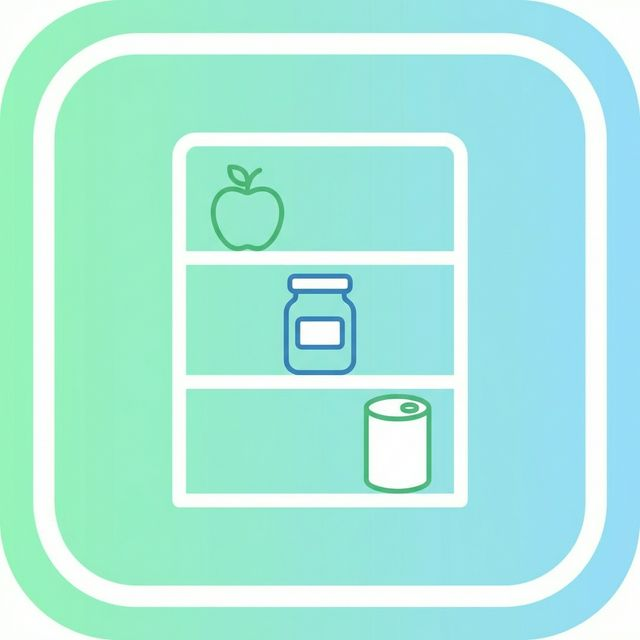

# Pantry Organizer & Web Dashboard

**Stop wasting food. Start managing your kitchen like a pro — on mobile and the web.**

A unified kitchen inventory platform featuring a cross-platform mobile app and a full-featured website dashboard that helps households track pantry inventory, manage shopping lists, plan weekly meals, and reduce food waste — all in one place.

[](https://reactnative.dev/)
[](https://expo.dev/)
[](https://expressjs.com/)
[](https://www.sqlite.org/)
[](https://firebase.google.com/)
[](https://www.typescriptlang.org/)
[](LICENSE)
[](https://expo.dev/)

</div>

---

## The Problem

The average household wastes **~30% of the food it buys** — often because items expire unnoticed, shopping is done from memory, or there's no plan for what to cook. Pantry Organizer solves this by giving you a real-time view of everything in your kitchen, automatic expiry alerts, a smart shopping list, and a meal planner that links directly to your inventory — accessible on both your smartphone and desktop browser.

---

## Product Preview

### 📱 Mobile Application (React Native / Expo)

<div align="center">
<table>
  <tr>
    <td align="center"><b>Home Dashboard</b></td>
    <td align="center"><b>Pantry Inventory</b></td>
    <td align="center"><b>Shopping List</b></td>
  </tr>
  <tr>
    <td>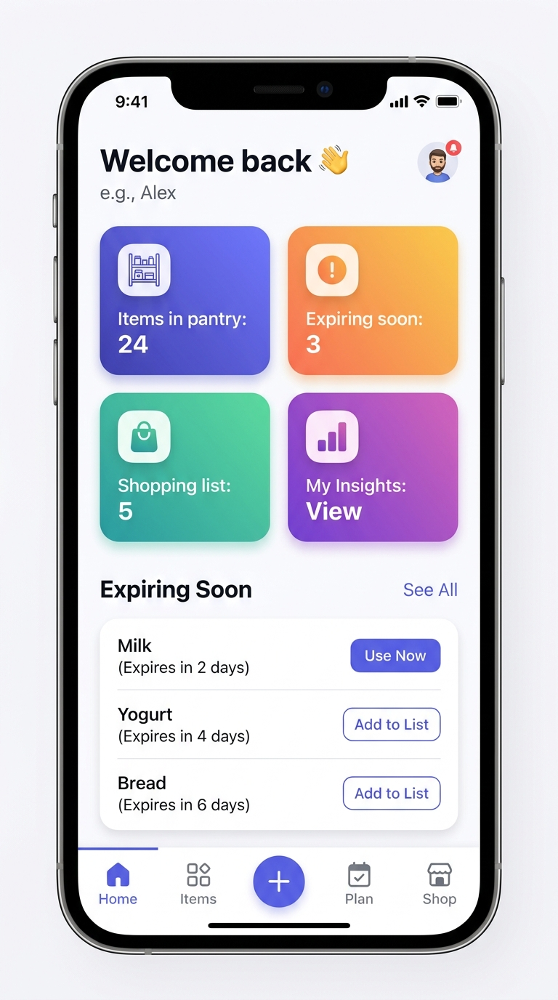</td>
    <td>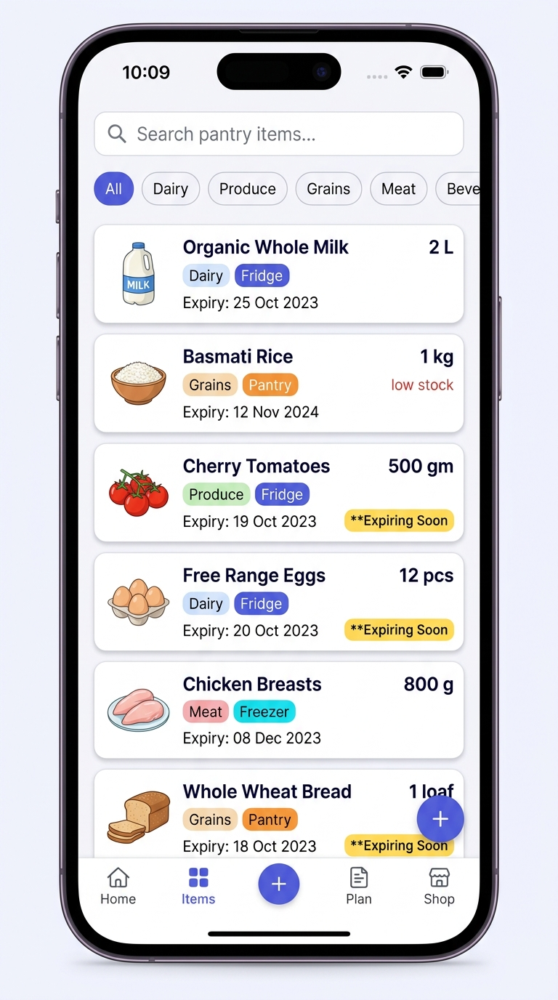</td>
    <td>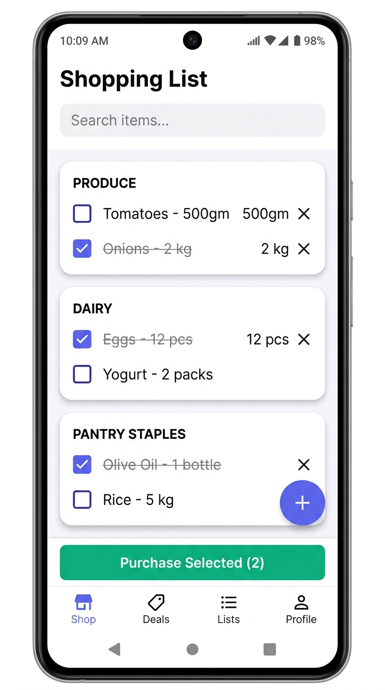</td>
  </tr>
  <tr>
    <td align="center"><b>Meal Planner</b></td>
    <td align="center"><b>Insights & Stats</b></td>
    <td align="center"><b>Login</b></td>
  </tr>
  <tr>
    <td>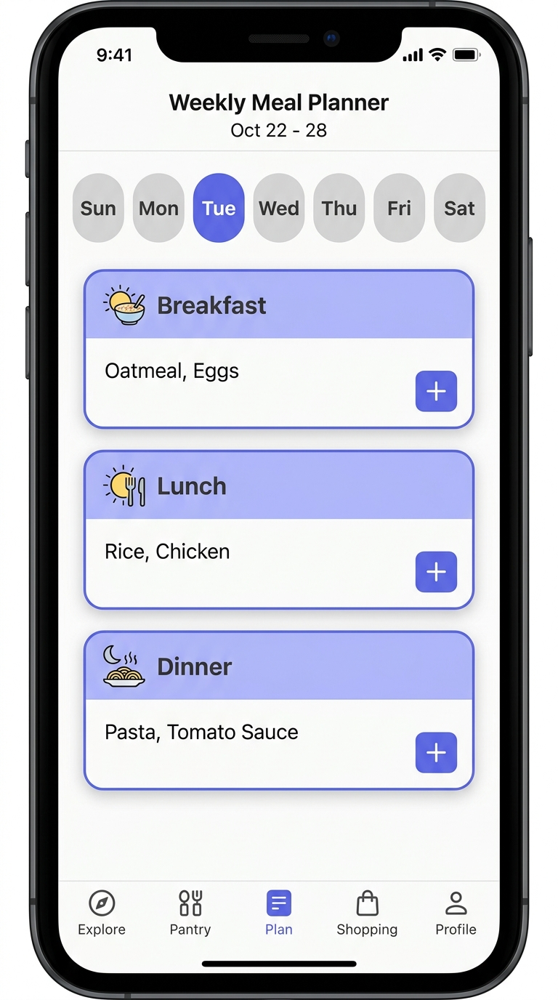</td>
    <td>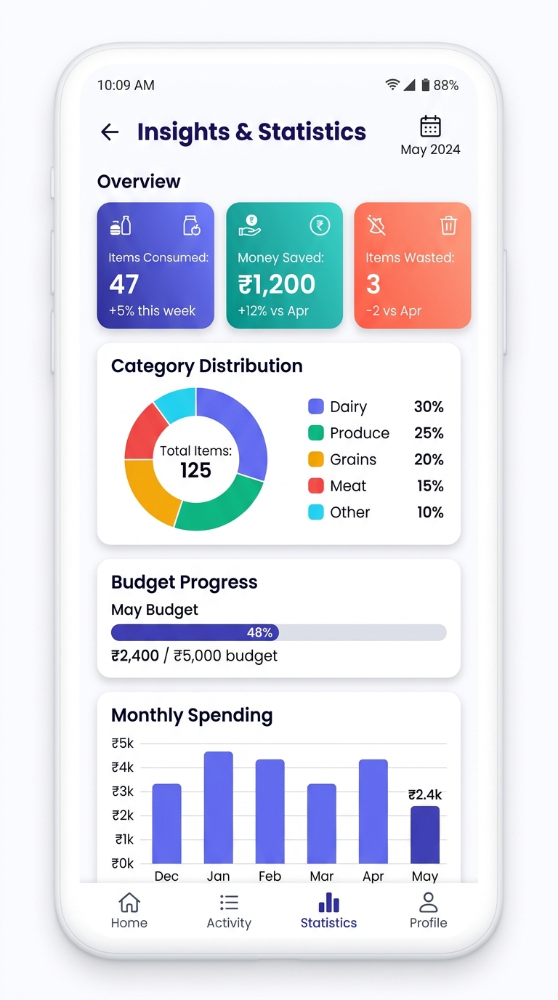</td>
    <td>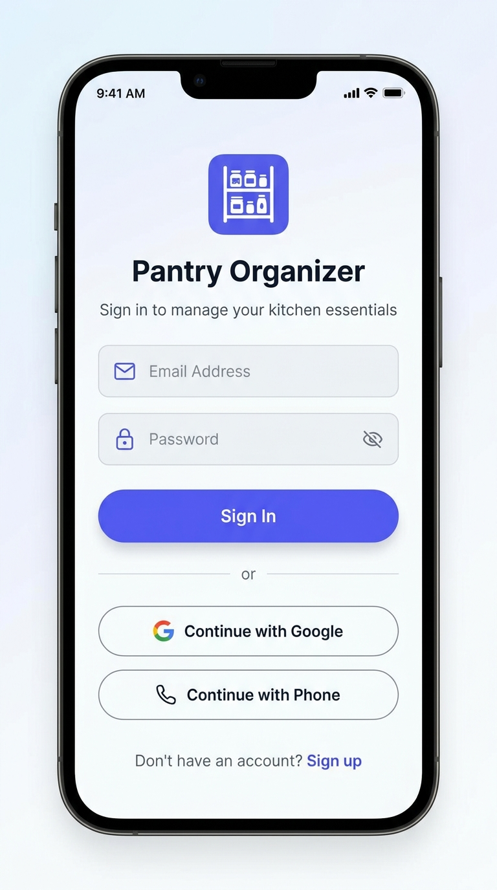</td>
  </tr>
</table>
</div>

### 💻 Website Dashboard Companion (Desktop & Tablet)

<div align="center">
<table>
  <tr>
    <td align="center"><b>Landing & Marketing Page</b></td>
    <td align="center"><b>Pantry Inventory Dashboard</b></td>
  </tr>
  <tr>
    <td>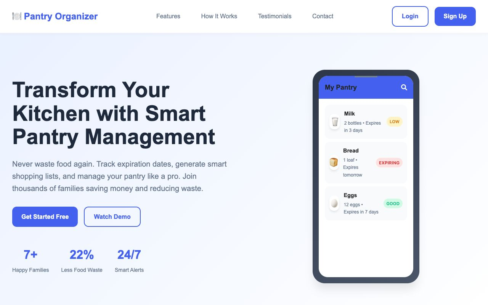</td>
    <td>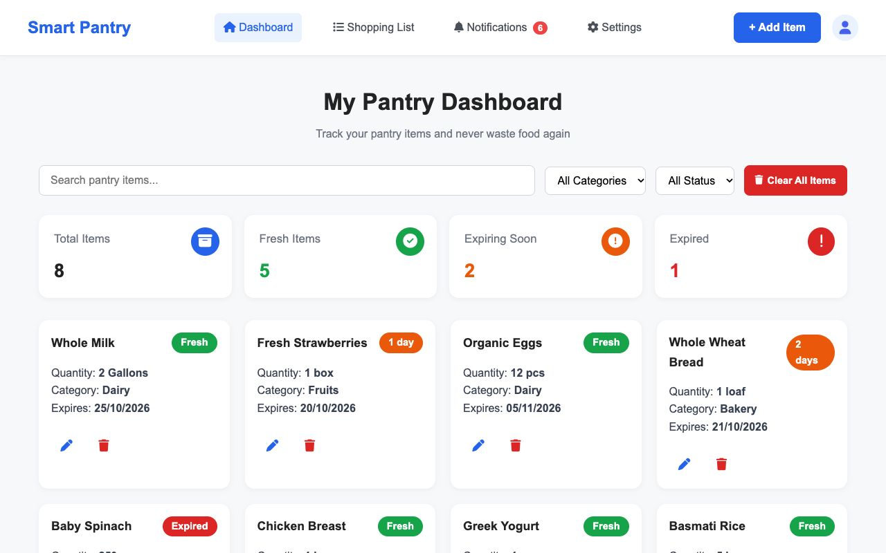</td>
  </tr>
  <tr>
    <td align="center"><b>Interactive Shopping List</b></td>
    <td align="center"><b>Settings & Preferences</b></td>
  </tr>
  <tr>
    <td>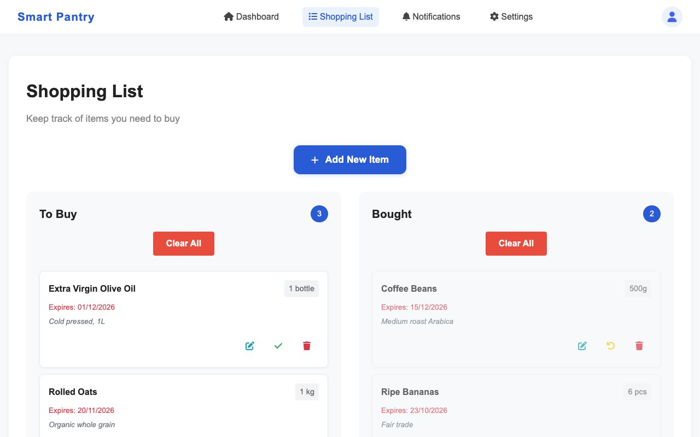</td>
    <td>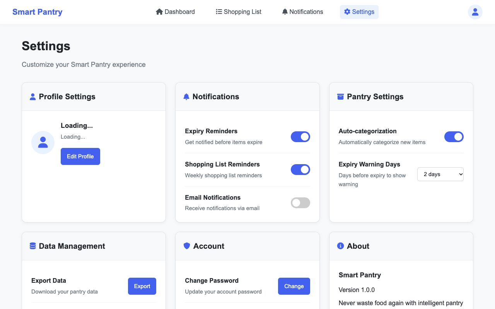</td>
  </tr>
</table>
</div>

---

## Table of Contents

- [Key Features](#key-features)
- [Technology Stack](#technology-stack)
- [Architecture](#architecture)
- [Getting Started](#getting-started)
- [Project Structure](#project-structure)
- [Mobile App Usage Guide](#mobile-app-usage-guide)
- [Website Dashboard Manual](#website-dashboard-manual)
- [Configuration](#configuration)
- [Deployment](#deployment)
- [Roadmap](#roadmap)
- [Contributing](#contributing)
- [License](#license)
- [Contact](#contact)

---

## Key Features

### 📦 Pantry Inventory Management
Track every item in your kitchen with name, quantity, unit, storage location (Pantry / Fridge / Freezer), category labels, and expiry dates. Filter, search, and sort items to find what you need instantly.

### 💻 Full-Featured Website Dashboard
Access your kitchen inventory anytime from a desktop or tablet browser. View comprehensive summary cards (Total Items, Fresh Items, Expiring Soon, Expired), execute instant live searches, filter by 11 categories or freshness status, add items with interactive modals, and edit or clear items with immediate visual feedback.

### ⏰ Smart Expiry Alerts
Receive push notifications on mobile and browser alerts before items expire. Reminders are calculated based on your custom threshold (1–7 days before expiry) to help you use food before it spoils.

### 🛒 Dual-Platform Shopping Lists
Maintain an organized shopping list on both mobile and web. On mobile, use the built-in purchase flow to log prices, set storage locations, and auto-transfer items into your pantry. On the web dashboard, easily divide items between "To Buy" and "Bought" with category tags and single-click completion toggles.

### 🍽️ Weekly Meal Planner
Plan breakfast, lunch, and dinner for every day of the week. Link meals directly to pantry items to automatically track ingredient usage and keep your inventory accurate.

### 📊 Insights & Budget Tracking
Visualize your pantry with interactive charts — category distribution (pie chart), monthly spending (bar chart), consumption trends, and a monthly budget tracker with progress bar.

### 👨‍👩‍👧‍👦 Family Sharing
Create or join a family group with a unique invite code. All family members share the same pantry, shopping list, and meal plans — synced in real time via Firestore.

### 📤 Multi-Format Data Export
Export your pantry inventory to CSV or generate a formatted PDF report on mobile. On the web dashboard, perform a one-click structured JSON export of all pantry items and shopping lists for complete data ownership.

### 🔐 Multi-Method Authentication & Security
Sign in with email/password, Google OAuth, GitHub OAuth, or SMS verification. Protected by Helmet security headers, rate limiting (general, auth, and strict tiers), CORS policies, and SQLite session storage.

### 🔔 Scheduled Reminders & Web Notification Hub
Automatic daily meal prep reminders (breakfast, lunch, dinner) and weekly shopping reminders on mobile. On the web, a dedicated Notification Center highlights stock depletion and upcoming expiries with unread badge indicators.

### 👤 Profile & System Customization
Upload profile avatars, view consumption statistics, configure notification preferences, set expiry warning intervals, and manage data wipes — across both mobile and web interfaces.

---

## Technology Stack

### Mobile App (`PantryOrganizerApp/`)

| Layer | Technology |
|---|---|
| **Framework** | React Native 0.81 with Expo SDK 54 |
| **Language** | TypeScript 5.9 |
| **Navigation** | React Navigation (Bottom Tabs + Native Stack) |
| **UI Components** | React Native Paper (Material Design 3) |
| **Animations** | React Native Reanimated |
| **Charts** | react-native-chart-kit |
| **Authentication** | Firebase Auth (Email, Google OAuth, Phone) |
| **Database** | Cloud Firestore (real-time sync) |
| **File Storage** | Firebase Storage (profile photos) |
| **Notifications** | Expo Notifications (local + push) |
| **State Management** | React Context + Firestore listeners |
| **Form Validation** | Formik + Yup |
| **Export** | expo-print (PDF) + expo-sharing (CSV) |

### Website Dashboard Frontend (`public/`)

| Layer | Technology |
|---|---|
| **Structure** | Semantic HTML5 (Dashboard, Shopping List, Settings, Auth, Support, Demo) |
| **Styling** | Vanilla CSS3 (Custom design system, CSS variables, responsive grid & flexbox) |
| **Logic & State** | Vanilla JavaScript (ES6+, Fetch API, async/await, DOM controllers) |
| **Icons** | Font Awesome 6.4 (Free CDN) |
| **Navigation** | Sticky responsive navbar with dynamic unread notification badge & avatar |
| **Modals** | CSS-animated overlay modals for Add/Edit Item and Confirmation flows |
| **Data Format** | REST JSON communication with Express backend |

### Backend API & Web Server (Root `/`)

| Layer | Technology |
|---|---|
| **Runtime** | Node.js ≥ 16 |
| **Framework** | Express.js 4.18 |
| **Static Serving** | Express Static Middleware (serving `/public` SPA) |
| **Database** | SQLite 3 (via sqlite3 + connect-sqlite3 sessions) |
| **Auth & Sessions** | Passport.js (Local, Google OAuth 2.0, GitHub OAuth) + express-session |
| **Security** | Helmet headers, CORS origin filtering, express-rate-limit, input sanitization |
| **Email** | Nodemailer (SMTP with Gmail/custom provider support) |
| **Validation** | express-validator + custom sanitizers |
| **Logging** | Winston (multi-transport) + Morgan HTTP request logger |
| **Testing** | Jest + Supertest |
| **Containerization** | Docker + Docker Compose |
| **Deployment** | Render (`render.yaml`) |

---

## Architecture

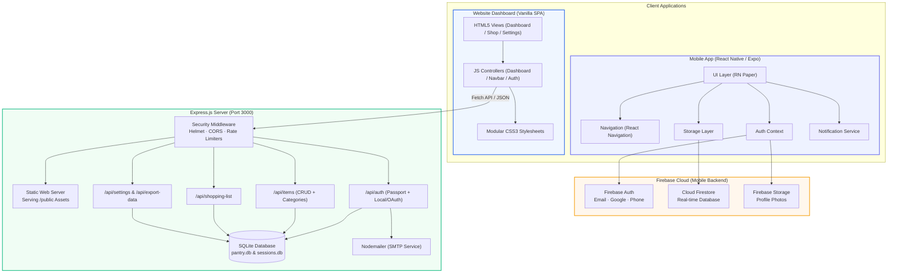

### Data Flow

1. **Authentication** — Users sign in via Firebase Auth. On success, the app subscribes to the user's Firestore document to resolve family membership.
2. **Pantry Data** — Items are stored in `/pantries/{userId}/items/` (or `/pantries/{familyId}/items/` for family mode). Firestore `onSnapshot` listeners provide real-time updates.
3. **Shopping List** — Stored in `/shoppingLists/{userId}/items/`. The purchase flow creates pantry entries and removes shopping list entries atomically.
4. **Meal Plans** — Stored in `/pantries/{userId}/mealPlans/{date}` with breakfast/lunch/dinner arrays linking to pantry items.
5. **Notifications** — Scheduled locally on-device via Expo Notifications. Expiry reminders trigger 2 days before expiry at 9 AM.

---

## Getting Started

### Prerequisites

| Tool | Version | Purpose |
|---|---|---|
| **Node.js** | ≥ 16.0.0 | JavaScript runtime |
| **npm** | ≥ 8.0.0 | Package manager |
| **Expo CLI** | Latest | Mobile app development |
| **Android Studio** or **Xcode** | Latest | Device emulator (optional) |
| **Firebase Project** | — | Backend services for mobile app |

### 1. Clone the Repository

```bash
git clone https://github.com/sparsh-sharma-08/PantryOrganizer.git
cd PantryOrganizer
```

### 2. Set Up the Mobile App

```bash
cd PantryOrganizerApp
npm install
```

#### Configure Firebase

1. Create a project at [Firebase Console](https://console.firebase.google.com/).
2. Enable **Authentication** (Email/Password, Google, Phone).
3. Create a **Firestore Database** in production mode.
4. Deploy the security rules from [`PantryOrganizerApp/firestore.rules`](PantryOrganizerApp/firestore.rules).
5. Update the Firebase config in [`src/firebaseConfig.ts`](PantryOrganizerApp/src/firebaseConfig.ts) with your project's credentials:

```typescript
export const firebaseConfig = {
    apiKey: "YOUR_API_KEY",
    authDomain: "YOUR_PROJECT.firebaseapp.com",
    projectId: "YOUR_PROJECT_ID",
    storageBucket: "YOUR_PROJECT.firebasestorage.app",
    messagingSenderId: "YOUR_SENDER_ID",
    appId: "YOUR_APP_ID",
    measurementId: "YOUR_MEASUREMENT_ID"
};
```

#### Run the App

```bash
# Start the Expo development server
npx expo start

# Or run directly on a platform
npx expo run:android
npx expo run:ios
```

### 3. Launch the Website Dashboard & Backend Server

The Express.js server provides both the **Website Dashboard SPA** and the **REST API** with SQLite database storage, Passport authentication, and email delivery.

```bash
# From the project root
npm install
```

#### Create a `.env` file

```env
PORT=3000
NODE_ENV=development
JWT_SECRET=your-strong-jwt-secret-min-32-chars
SESSION_SECRET=your-strong-session-secret

# Email (for contact form / notifications)
EMAIL_SERVICE=gmail
EMAIL_USER=your-email@gmail.com
EMAIL_PASS=your-app-password
SUPPORT_EMAIL=support@yourdomain.com

# OAuth (optional)
GOOGLE_CLIENT_ID=your-google-client-id
GOOGLE_CLIENT_SECRET=your-google-client-secret
GITHUB_CLIENT_ID=your-github-client-id
GITHUB_CLIENT_SECRET=your-github-client-secret

# CORS
FRONTEND_URL=http://localhost:3000
```

#### Start the Server

```bash
# Production server
npm start

# Development server (with auto-reload)
npm run dev
```

Once running, access the web applications and endpoints in your browser:
- **Landing Page**: [`http://localhost:3000`](http://localhost:3000)
- **Web Dashboard**: [`http://localhost:3000/dashboard.html`](http://localhost:3000/dashboard.html)
- **Shopping List**: [`http://localhost:3000/shopping-list.html`](http://localhost:3000/shopping-list.html)
- **Settings & Export**: [`http://localhost:3000/settings.html`](http://localhost:3000/settings.html)
- **Health Check**: [`http://localhost:3000/api/health`](http://localhost:3000/api/health)

### 4. Docker Setup (Optional)

```bash
# Build and run all services
docker-compose up -d

# Or build manually
docker build -t pantry-organizer .
docker run -p 3000:3000 --env-file .env pantry-organizer
```

---

## Project Structure

```
PantryOrganizer/
├── PantryOrganizerApp/             # React Native mobile app (Expo)
│   ├── App.tsx                     # App entry — navigation, auth, providers
│   ├── app.json                    # Expo configuration
│   ├── eas.json                    # EAS Build configuration
│   ├── firestore.rules             # Firestore security rules
│   ├── assets/                     # App icon, splash screen
│   └── src/
│       ├── components/             # Reusable UI components
│       │   ├── Header.tsx          # App header with profile avatar
│       │   ├── ModernTabBar.tsx    # Custom bottom tab bar
│       │   ├── ItemCard.tsx        # Pantry item card
│       │   ├── StatCard.tsx        # Dashboard stat card
│       │   ├── AddMealSelector.tsx # Meal planner item picker
│       │   └── SwipeableItem.tsx   # Swipe-to-delete component
│       ├── screens/                # Application screens
│       │   ├── Home.tsx            # Dashboard with stats & expiring items
│       │   ├── PantryList.tsx      # Full pantry inventory
│       │   ├── AddItem.tsx         # Add / edit pantry item
│       │   ├── ItemDetail.tsx      # Item detail view
│       │   ├── ShoppingList.tsx    # Shopping list with purchase flow
│       │   ├── PlannerScreen.tsx   # Weekly meal planner
│       │   ├── StatsScreen.tsx     # Charts, budget, insights
│       │   ├── FamilyScreen.tsx    # Family group management
│       │   ├── Profile.tsx         # User profile & data export
│       │   ├── SettingsScreen.tsx  # App settings & notifications
│       │   ├── LoginScreen.tsx     # Email, Google, Phone login
│       │   ├── SignupScreen.tsx    # Account registration
│       │   ├── SplashScreen.tsx    # Animated splash screen
│       │   └── SupportScreen.tsx   # Help & contact support
│       ├── context/
│       │   └── AuthContext.tsx     # Firebase auth state provider
│       ├── services/
│       │   └── NotificationService.ts  # Push & local notifications
│       ├── storage/
│       │   └── store.ts           # Firestore data layer & caching
│       ├── utils/
│       │   ├── exportUtils.ts     # CSV & PDF export
│       │   └── notifications.ts   # Notification scheduling helpers
│       ├── firebaseConfig.ts      # Firebase initialization
│       ├── theme.ts               # Design tokens & color palette
│       └── types.ts               # TypeScript interfaces
│
├── server.js                       # Express web server & static SPA host
├── database.js                     # SQLite database schema & initialization
│
├── public/                         # Website Dashboard Frontend (SPA)
│   ├── index.html                  # Landing page & feature showcase
│   ├── dashboard.html              # Main pantry inventory web dashboard
│   ├── shopping-list.html          # Dual-column shopping list manager
│   ├── notification.html           # Alerts & notification center
│   ├── settings.html               # User profile, alert limits, & data export
│   ├── login.html / signup.html    # User authentication & registration
│   ├── support.html                # Support desk & contact form
│   ├── watch-demo.html             # Video demo presentation
│   ├── styles/                     # Modular CSS design system
│   │   ├── main.css                # Global styles, variables, typography
│   │   ├── dashboard.css           # Grid layouts & status badges
│   │   ├── shopping-list.css       # Shopping list layouts & modals
│   │   ├── navigation.css          # Sticky navbar & badges
│   │   └── settings.css            # Settings panels & forms
│   └── scripts/                    # Client-side JavaScript controllers
│       ├── navbar.js               # Shared navbar, notifications, & avatar
│       ├── dashboard.js            # Pantry CRUD, search, filter, & cards
│       ├── shopping-list.js        # Shopping list operations & modals
│       └── settings.js             # Account, alerts, & JSON data export
│
├── routes/                         # Express REST API routes
│   ├── auth.js                     # Local & OAuth authentication endpoints
│   ├── items.js                    # Pantry inventory CRUD & categories
│   ├── shopping.js                 # Shopping list operations
│   └── settings.js                 # User profile & system preferences
│
├── middleware/                     # Express middleware pipeline
│   ├── requireAuth.js              # Token & session auth guard
│   ├── security.js                 # Helmet, CORS, CSRF, & rate limiters
│   └── errorHandler.js             # Centralized JSON error responder
│
├── utils/                          # Server utilities
│   ├── logger.js                   # Winston & Morgan stream logging
│   └── backup.js                   # SQLite database automated backups
│
├── Dockerfile                      # Container build
├── docker-compose.yml              # Multi-service orchestration
├── render.yaml                     # Render deployment config
├── package.json                    # Backend dependencies & scripts
├── .eslintrc.js                    # ESLint rules
│
├── DEPLOYMENT_CHECKLIST.md         # Production deployment guide
├── GOOGLE_OAUTH_SETUP.md          # Google OAuth setup instructions
├── GITHUB_OAUTH_SETUP.md          # GitHub OAuth setup instructions
├── RENDER_DEPLOYMENT.md           # Render hosting guide
└── docs/
    └── screenshots/                # Mobile and Web application screenshots
```

---

## Mobile App Usage Guide

### Adding Items to Your Pantry

1. Tap the **+** button in the bottom tab bar.
2. Enter the item name, quantity, and unit (pcs, kg, L, etc.).
3. Select a storage location — **Pantry**, **Fridge**, or **Freezer**.
4. Add category labels (Dairy, Produce, Grains, Meat, Beverages).
5. Optionally set an expiry date — the app will schedule an automatic reminder.
6. Tap **Save** to add the item.

### Managing Your Shopping List

1. Navigate to the **Shop** tab.
2. Tap the **+** FAB to add items with quantity, unit, category, and notes.
3. Check items off as you shop.
4. Select purchased items and tap **Purchase Selected** to enter the purchase flow.
5. Set storage location, expiry date, and price per item.
6. Items are moved from the shopping list into your pantry automatically.

### Planning Meals

1. Navigate to the **Plan** tab to open the weekly meal planner.
2. Select a day from the horizontal week selector.
3. Tap **+** on any meal slot (Breakfast, Lunch, Dinner).
4. Choose items from your pantry inventory or add custom entries.
5. Mark meals as **Cooked** to deduct quantities from your pantry.

### Tracking Insights

1. Tap the **My Insights** card on the home dashboard.
2. View category distribution, monthly spending charts, and consumption trends.
3. Set a monthly budget to track spending against your target.

### Family Sharing

1. Go to **Profile → Family**.
2. Create a new family group (generates a unique invite code).
3. Share the code with family members — they tap **Join Family** and enter the code.
4. All members now share the same pantry, shopping list, and meal plans in real time.

---

## Website Dashboard Manual

The Website Dashboard provides household members with a centralized kitchen command center accessible from any desktop or laptop browser.

### 1. Authentication & Session Setup
1. Launch the server (`npm start`) and navigate to [`http://localhost:3000`](http://localhost:3000) or direct login at [`http://localhost:3000/login.html`](http://localhost:3000/login.html).
2. Register a new account via [`signup.html`](http://localhost:3000/signup.html) or sign in with your credentials (or third-party OAuth if configured).
3. Upon authentication, a secure session token is saved in browser storage to maintain state across pages.
4. Your user avatar and live unread notification badge will appear in the top-right corner of the sticky navigation bar.

### 2. Reading Dashboard Metrics & Status Badges
At the top of the pantry dashboard, four color-coded metric cards summarize the current status of your inventory:
- **Total Items** (Blue archive icon): Total count of pantry items currently registered in your account.
- **Fresh Items** (Green checkmark icon): Items with ample shelf life remaining (> 2 days).
- **Expiring Soon** (Orange warning icon): Items expiring within your threshold (default: ≤ 2 days).
- **Expired** (Red exclamation icon): Items that have passed their expiration date and require attention.

Each inventory card displays:
- Item name and quantity (e.g., `2 Gallons`, `1 box`, `500g`)
- Assigned category tag (e.g., `Dairy`, `Bakery`, `Fruits`, `Meat`)
- Formatted expiration date (`DD/MM/YYYY`)
- Color-coded freshness pill (`Fresh` in green, `X days` countdown in orange, `Expired` in red)
- Action buttons: Quick Edit (pencil icon) and Instant Delete (trash icon)

### 3. Searching, Filtering, and Managing Inventory
- **Instant Search**: Type in the search input to filter items by name in real time without page reload.
- **Category Filter**: Select any food category from the dropdown to narrow your view (`Dairy`, `Bakery`, `Fruits`, `Vegetables`, `Meat`, `Grains`, `Snacks`, `Beverages`, `Frozen`, `Condiments`, `Other`).
- **Status Filter**: Isolate items by freshness state (`All Status`, `Fresh`, `Expiring`, `Expired`).
- **Clear All Items**: Use the red **Clear All Items** button (with confirmation modal) to reset your pantry inventory.

### 4. Adding and Editing Items via Modals
- **Add New Item**: Click the blue **+ Add Item** button in the top navbar.
  - Fill in Item Name, Quantity, Category, and Expiry Date.
  - Click **Add** to persist the record to SQLite and update the grid dynamically.
- **Edit Item**: Click the blue pencil icon on any item card to open the pre-filled Edit modal.
  - Modify quantity, category, or expiry date, then click **Save Changes**.
- **Delete Item**: Click the red trash icon on any card to remove it immediately.

### 5. Working with the Dual-Column Shopping List
Navigate to **Shopping List** via the navbar:
- **Add New Item**: Click **+ Add New Item** to open the modal. Specify item name, quantity needed, category, anticipated expiry date, and optional notes (e.g., brand or store preferences).
- **To Buy Section**: Displays all active shopping items with expiry dates and notes. Click the green checkmark icon to move an item to **Bought** once purchased.
- **Bought Section**: Displays items currently in your cart or recently acquired. Click the undo icon to return an item to **To Buy**, or pencil icon to edit.
- **Clear All**: Each section features an independent **Clear All** button to clean up lists after grocery shopping.

### 6. Monitoring Stock & Expiry Notifications
Click the **Notifications** link in the navbar (complete with live unread badge count):
- **Stock Running Low**: Automatically triggered whenever item quantities fall to 2 or fewer units.
- **Expiry Warnings**: Flags items that are within your warning window (e.g., expiring in 1 or 2 days).
- **Clearing Alerts**: Dismiss individual notifications or click **Clear All Notifications** to acknowledge.

### 7. Configuring Settings & Data Export
Click **Settings** in the navbar to open the preferences panel:
- **Profile Settings**: View account information and upload/edit profile pictures.
- **Notification Toggles**: Turn browser-based Expiry Reminders and Shopping List Reminders on or off.
- **Expiry Warning Days**: Set your alert threshold between `1 day` to `7 days` before expiration.
- **Data Management & Export**: Click **Export Data** to generate a complete, structured JSON file (`pantry-data-YYYY-MM-DD.json`) containing all your pantry items, shopping lists, and user metadata for backup or analysis.
- **Account Actions**: Update account password or securely delete account with OTP verification.

---

## Configuration

### Environment Variables (Backend API)

| Variable | Required | Description |
|---|---|---|
| `PORT` | No | Server port (default: `3000`) |
| `NODE_ENV` | Yes | `development` or `production` |
| `JWT_SECRET` | Yes | Secret key for JWT token signing (min 32 chars) |
| `SESSION_SECRET` | Yes | Secret for express-session |
| `EMAIL_SERVICE` | No | SMTP provider (e.g., `gmail`) |
| `EMAIL_USER` | No | Sender email address |
| `EMAIL_PASS` | No | App-specific email password |
| `SUPPORT_EMAIL` | No | Support inbox for contact form |
| `FRONTEND_URL` | Yes | Allowed CORS origin |
| `GOOGLE_CLIENT_ID` | No | Google OAuth client ID |
| `GOOGLE_CLIENT_SECRET` | No | Google OAuth client secret |
| `GITHUB_CLIENT_ID` | No | GitHub OAuth client ID |
| `GITHUB_CLIENT_SECRET` | No | GitHub OAuth client secret |

### Firebase Configuration (Mobile App)

The mobile app requires a Firebase project with:
- **Authentication** — Email/Password, Google, and Phone providers enabled
- **Firestore** — Database created with security rules deployed
- **Storage** — Bucket configured for profile photo uploads

See [`GOOGLE_OAUTH_SETUP.md`](GOOGLE_OAUTH_SETUP.md) for detailed Google OAuth configuration.

### Available Scripts

```bash
# Backend API
npm start              # Start production server
npm run dev            # Start with nodemon (auto-reload)
npm test               # Run Jest test suite
npm run test:coverage  # Run tests with coverage report
npm run lint           # Run ESLint
npm run lint:fix       # Auto-fix lint issues
npm run backup         # Create database backup
npm run health-check   # Check API health endpoint

# Mobile App (from PantryOrganizerApp/)
npx expo start         # Start Expo dev server
npx expo run:android   # Build and run on Android
npx expo run:ios       # Build and run on iOS
npx expo start --web   # Start web version
```

---

## Deployment

### Mobile App — EAS Build

```bash
cd PantryOrganizerApp

# Install EAS CLI
npm install -g eas-cli

# Build for Android (APK)
eas build --platform android --profile preview

# Build for production
eas build --platform android --profile production
eas build --platform ios --profile production
```

See [`eas.json`](PantryOrganizerApp/eas.json) for build profile configuration.

### Backend API — Render

The project includes a [`render.yaml`](render.yaml) for one-click deployment to [Render](https://render.com/):

1. Push your code to GitHub.
2. Create a new **Web Service** on Render and connect your repository.
3. Render will auto-detect `render.yaml` and configure the service.
4. Set all required environment variables in the Render dashboard.

See [`RENDER_DEPLOYMENT.md`](RENDER_DEPLOYMENT.md) for a detailed guide.

### Backend API — Docker

```bash
docker-compose up -d
```

This starts three services:
- **pantry-organizer** — Node.js app on port `3000`
- **redis** — Session store (optional, port `6379`)
- **nginx** — Reverse proxy (ports `80`/`443`)

See [`DEPLOYMENT_CHECKLIST.md`](DEPLOYMENT_CHECKLIST.md) for the full production readiness checklist.

---

## Roadmap

### Implemented
- [x] Pantry inventory with CRUD operations
- [x] Category labels and storage locations
- [x] Expiry date tracking with push notifications
- [x] Shopping list with categorized purchase flow
- [x] Weekly meal planner (Breakfast / Lunch / Dinner)
- [x] Analytics dashboard with charts and budget tracking
- [x] Family sharing with invite codes
- [x] Multi-method auth (Email, Google, Phone)
- [x] CSV and PDF data export
- [x] Profile photo upload
- [x] Swipe-to-delete and quantity adjustment modals
- [x] Scheduled meal prep and shopping reminders
- [x] Docker and Render deployment support
- [x] Web dashboard companion (Express static SPA with pantry inventory grid, dual-column shopping list, and settings)

### Planned
- [ ] Real-time sync bridge between mobile app (Firestore) and web dashboard (SQLite)
- [ ] Barcode scanner for quick item entry
- [ ] Recipe suggestions based on available ingredients
- [ ] Dark mode theme
- [ ] Item price history and price comparison
- [ ] Recurring shopping list templates
- [ ] Multi-language support (i18n)
- [ ] Apple Sign-In

---

## Contributing

Contributions are welcome. Here's how to get started:

1. **Fork** the repository.
2. **Create a branch** for your feature or fix:
   ```bash
   git checkout -b feature/your-feature-name
   ```
3. **Make your changes** and ensure they follow the project's ESLint rules:
   ```bash
   npm run lint
   ```
4. **Test** your changes:
   ```bash
   npm test
   ```
5. **Commit** with a clear message:
   ```bash
   git commit -m "feat: add barcode scanning support"
   ```
6. **Push** and open a **Pull Request** against `main`.

### Reporting Issues

Use the [GitHub Issues](https://github.com/sparsh-sharma-08/PantryOrganizer/issues) tracker to report bugs or request features. Include:
- Steps to reproduce the issue
- Expected vs. actual behavior
- Device/OS information (for mobile bugs)
- Screenshots or logs if available

---

## License

This project is licensed under the **MIT License**. See the [LICENSE](PantryOrganizerApp/LICENSE) file for details.

---

## Acknowledgements

- [Expo](https://expo.dev/) — Cross-platform mobile development framework
- [React Native Paper](https://callstack.github.io/react-native-paper/) — Material Design component library
- [Firebase](https://firebase.google.com/) — Authentication, Firestore, and Storage
- [react-native-chart-kit](https://github.com/indiespirit/react-native-chart-kit) — Charting library
- [Express.js](https://expressjs.com/) — Node.js web framework
- [Material Community Icons](https://materialdesignicons.com/) — Icon set used throughout the app

---

## Contact

**Sparsh Sharma** — Creator & Maintainer

- Email: [sparshsharma0825@gmail.com](mailto:sparshsharma0825@gmail.com)
- GitHub: [@sparsh-sharma-08](https://github.com/sparsh-sharma-08)
- Issues: [PantryOrganizer/issues](https://github.com/sparsh-sharma-08/PantryOrganizer/issues)

---

<div align="center">

Built with ❤️ in Chandigarh, India

</div>
